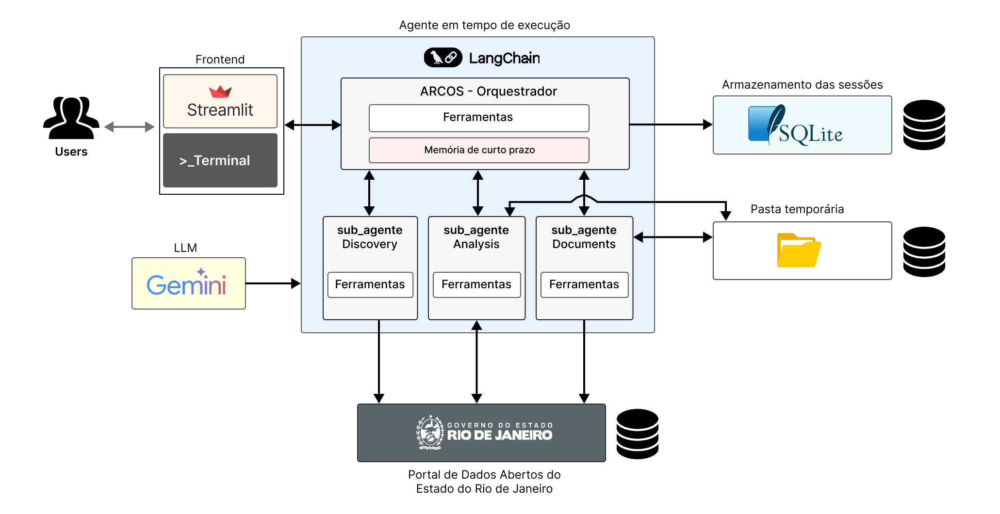

<h1 align="center">ARCOS-RJ</h1>


---

## Sobre o Projeto

**ARCOS-RJ** é um agente de IA conversacional que está em desenvolvimento como trabalho de conclusão de curso na disciplina de Projeto Final do bacharelado em Ciência da Computação na Universidade do Estado do Rio de Janeiro (UERJ).

O sistema é um assistente conversacional que facilita o acesso e análise de dados públicos do Rio de Janeiro, abstraindo a complexidade da navegação da plataforma de dados abertos.

---

## Motivação

A plataforma [Dados Abertos do RJ](https://dadosabertos.rj.gov.br/) contém um extenso acervo de informações públicas. Os usuários da plataforma podem encontrar alguns desafios ao navegar entre os grupos de arquivos:

- **Segmentação dos dados**: grande quantidade de bases de dados espalhadas pela plataforma
- **Navegação é confusa**: usuários que não conhecem a plataforma não são capazes de encontrar informações desejadas com facilidade
- **Volume de arquivos**: não há clareza na categorização e descrição dos recursos armazenados
- **Formatos dos arquivos**: diferentes formatos (CSV, XLSX, ZIP, PDF) exigem processamento manual
- **Alta complexidade em análises**: é necessário realizar download dos arquivos e descompactá-los para poder visualizar-los. Para fazer análises simples é necessário conhecer ferramentas que manipulem planilhas.

### Solução desenvolvida:

ARCOS-RJ se integra à **API de Dados Abertos do RJ**, abstraindo a complexidade técnica da navegação e análise. O usuário pode fazer perguntas em linguagem natural e o agente de IA pode:

- **Localizar** automaticamente a base de dados correta
- **Baixar** e processar arquivos em múltiplos formatos
- **Analisar** os dados conforme solicitado
- **Apresentar** resultados de forma acessível
- **Incentivar** extração de informações extras nos arquivos

Dessa forma, tanto um usuário leigo quanto um usuário mais experiente e conhecedor da plataforma de Dados Abertos é capaz de navegar e obter informações com o uso de linguagem natural.

---

## Funcionalidades

### Principais Ferramentas / Tools do Agente

| Ferramenta/Tool | Capacidade |
|-----------|-----------|
| **listar_bases** | Descobre as bases disponíveis no portal |
| **buscar_infos_base** | Encontra bases por nome ou descrição |
| **listar_recursos_da_base** | Lista arquivos disponíveis numa base específica |
| **baixar_arquivo_dados** | Baixa e processa arquivos (CSV, XLSX, ZIP) |
| **analisar_dados_arquivo** | Executa análises e operações sobre dados |
| **gerar_graficos** | Cria visualizações dos dados |
| **gerenciar_cache_sessao** | Gerencia cache local de arquivos |

---

##  Exemplos de Uso

### Exemplo 1: Buscar informação simples

```
👤 Você: Quantas pessoas andaram de ônibus em março?

🏖️ ARCOS-RJ:
   → Identifica base: setram_sgr (gratuidades)
   → Detecta período: março (arquivo consolidado)
   → Baixa dados automaticamente
   → Analisa e filtra por "ÔNIBUS"

   Em março de 2025, foram registradas **3.320.000** transações
   de gratuidade no modal ÔNIBUS. 📊
```

### Exemplo 2: Analisar dados específicos

```
👤 Você: Quantos idosos andaram de metrô em julho do ano passado?

🏖️ ARCOS-RJ:
   → Base: setram_sgr
   → Período: julho de 2024 (consolidado)
   → Localiza linha: METRÔ + Idoso

   Em julho de 2024, **500.000** idosos utilizaram o METRÔ
   através do programa de gratuidade.
```

### Exemplo 3: Gerar visualização

```
👤 Você: Quero um gráfico com a distribuição de idosos por turno em abril.

🏖️ ARCOS-RJ:
   → Baixa dados de abril
   → Agrupa por turno (manhã, tarde, noite, madrugada)
   → Gera gráfico de barras

   📊 Gráfico salvo! [Visualização]
   Maior uso: **Tarde** com 45% das transações.
```

### Exemplo 4: Consultar tarifas

```
👤 Você: Quanto custa a passagem do metrô hoje?

🏖️ ARCOS-RJ:
   → Base: concessionaria-metrorio
   → Operação: leitura_tarifa (atual)

   A passagem do MetrôRio hoje custa **R$ 7,90**. 💰
```

---

## 🏗️ Arquitetura (WIP: biblioteca Diagrams)



---

## Como Usar

> [!IMPORTANT]
> O agente foi desenvolvido em ambiente MacOS. Portanto, algumas ferramentas do projeto podem depender de compatibilidade com Unix.
> No Windows, o uso do *make* pelo PowerShell pode apresentar problemas nas configurações de Path. Dê preferência para o WSL para utilizar os comandos abaixo.

### I. Pré-requisitos

- [uv](https://docs.astral.sh/uv/getting-started/installation/)
- [make](https://www.gnu.org/software/make/)
- LLM Model: chave da [**Gemini API**](https://aistudio.google.com/app/api-keys) *ou* projeto no [**Google Cloud (Vertex AI)**](https://cloud.google.com/products/gemini-enterprise-agent-platform) *ou* [**Ollama**](https://ollama.com/library/qwen) rodando localmente. Para outras LLMs, adicionar condicional para suporte à sua LLM em **model.py** e modificar o **.env**, caso necessário.
- [pre-commit](https://pre-commit.com/)*

*para modificações no projeto

### II. Clonar o repositório

```bash
git clone <url-do-repositorio>
```

### III. Configurar as variáveis de ambiente

```bash
cp .env.example .env
```

Preencher com suas variáveis de ambiente que conectam o agente a sua LLM de preferência. Referência:

| Variável | Uso |
|---|---|
| `ROOT_AGENT_MODEL` | Nome do modelo. Se o nome contiver `gemini`, aponta para Gemini; senão, aponta para Ollama |
| `GEMINI_API_KEY` | Chave da Gemini API. Se ficar vazia, usa Vertex AI atrelado a um projeto e região |
| `GOOGLE_CLOUD_PROJECT`, `GOOGLE_CLOUD_LOCATION` | Só para Vertex AI, se usar API_KEY do Gemini, não preencha e/ou comente essa linha |
| `OLLAMA_BASE_URL` | Somente para Ollama (padrão `http://localhost:11434`). Se utilizar Gemini, desconsidere e/ou comente a linha |
| `URL_*` | Endpoints da API de Dados Abertos do RJ. **Não modificar!!!**  |

### IV. Criar o ambiente e instalar as dependências

Criação do ambiente virtual Python e instala as versões definidas em `pyproject.toml` e `uv.lock`.

```bash
make create-env
```

E ative o ambiente com:

```bash
source .venv/bin/activate
```

### V. Executar o Agente

Terminal (digite `/sair` para interromper a execução do agente ou apertar `CTRL+C`):

```bash
make run
```

Interface web simples (Streamlit):

```bash
make web
```

### Outros comandos

| Comando | O que faz |
|---|---|
| `make chat-history` | Mostra o histórico de conversas salvo no banco |
| `make f-chat-history` | Mostra o histórico formatado |
| `make delete-env` | Apaga o `.venv` |

---

## 🔐 API - endpoints do Portal de Dados Abertos

```env
# .env:

URL_LISTAR_BASES=https://dadosabertos.rj.gov.br/api/3/action/package_list
URL_BUSCAR_BASE=https://dadosabertos.rj.gov.br/api/3/action/package_search?q={}
URL_CONSULTAR_PROCESSAR_ARQUIVO=https://dadosabertos.rj.gov.br/api/3/action/package_show?id={}
```

---

## Dados mais apoiados pelo ARCOS

### Bases Principais - Maior quantidade de arquivos padronizados e recursos testados durante o desenvolvimento

1. **setram_sgr** - Gratuidades no Transporte
   - Dados mensais
   - Dados diários

2. **setram_sbe** - Bilhetagem Eletrônica
   - Validações e embarques
   - Volume de passageiros

2. **setram_sbu** - Bilhete Único
   - Dados mensais
   - Dados diários

3. **concessionaria-metrorio** - Tarifas do Metrô

4. **concessionaria-ccr-barcas** - Tarifas das Barcas

5. **concessionaria-supervia** - Tarifas dos Trens

---

**Departamento de Ciência da Computação**
**Instituto de Matemática e Estatística (IME)**
**Universidade do Estado do Rio de Janeiro (UERJ)**
